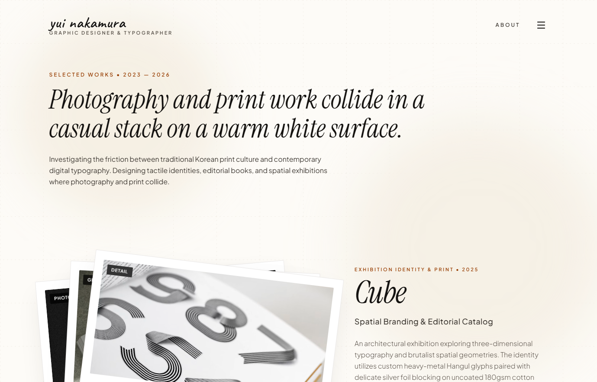
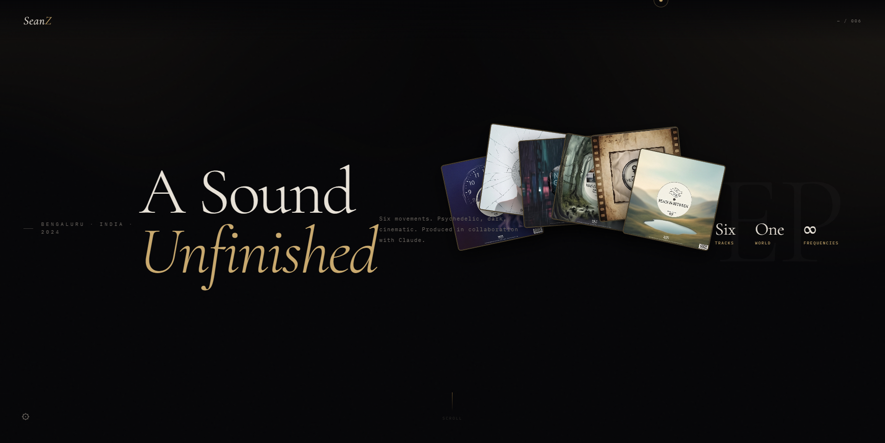
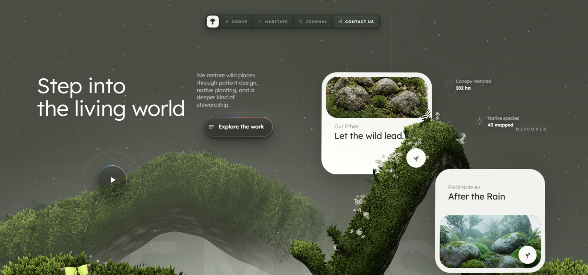
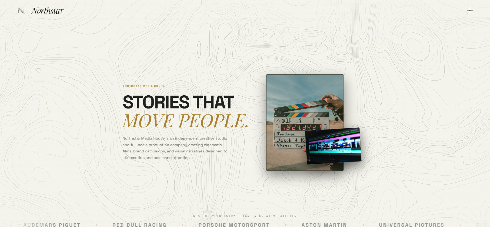
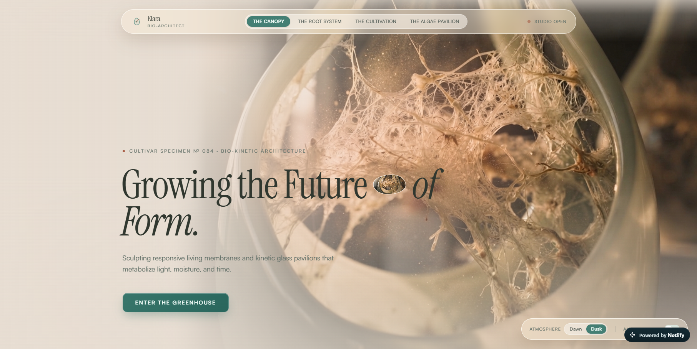
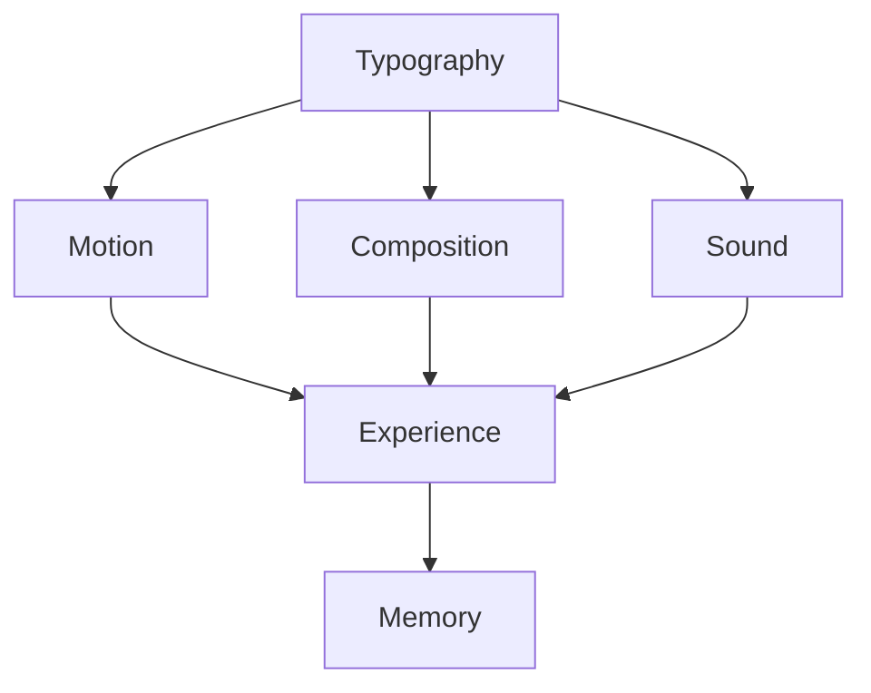

 

# ✦ FRONTEND DESIGN SHOWCASE

**Five sites. Five visual worlds. One obsession with making the web feel alive.**

 

 

[**01 · Yui Nakamura**](#yui) &nbsp;·&nbsp; [**02 · SEANZ**](#seanz) &nbsp;·&nbsp; [**03 · Nemus**](#nemus) &nbsp;·&nbsp; [**04 · Northstar**](#northstar) &nbsp;·&nbsp; [**05 · Elara Green**](#elara)

 

---

## `INDEX`

| № | Project | Discipline | Feels like | Live |
| :-: | :-- | :-- | :-- | :-: |
| `01` | **Yui Nakamura** | Editorial · Typography | Quiet, tactile, spacious | [↗ Visit](https://yuinakamura.netlify.app/) |
| `02` | **SEANZ** | Audio-first · Interaction | Cinematic, nocturnal, immersive | [↗ Enter](https://szproducer.netlify.app/) |
| `03` | **Nemus** | 3D · Shaders · Seasons | Alive, breathing, atmospheric | [↗ Explore](https://nemus-wildlife.netlify.app/) |
| `04` | **Northstar Media House** | Film · Brand · Motion | Bold, cinematic, emotional | [↗ Watch](https://northstar-media.netlify.app/) |
| `05` | **Elara Green · The Canopy** | Architecture · Organic Form | Grown, not built | [↗ Visit](https://elarabio-architect.netlify.app/) |

---

### `01` — `TYPOGRAPHY`

# Yui Nakamura

**GRAPHIC DESIGNER & TYPOGRAPHER**

`MATERIALITY` · `TYPOGRAPHY` · `GEOMETRY` · `YEOBAEK`

 

 

 

> *"What is left empty is still part of the composition."*

A minimalist editorial portfolio exploring the relationship between **typography, architecture, material, and space.** The interface was designed around one idea: a portfolio doesn't need to constantly demand attention. **Sometimes the whitespace is the interface.**

| Concept | Expression |
| :-- | :-- |
| **Tactile Materiality** | Texture · Grain · Surface · Material |
| **Architectural Typo-Geometry** | Form · Grid · Structure · Proportion |
| **여백 · Yeobaek** | Silence · Space · Balance · Absence |

`EDITORIAL` `TYPOGRAPHY` `MINIMALISM` `ART DIRECTION` `MOTION`

---

### `02` — `SOUND`

# SEANZ

**MUSIC PRODUCER · SOUND DESIGNER**

`SOUND` · `ATMOSPHERE` · `MOTION` · `INTERACTION`

 

 

 

> *"Not a portfolio. A world built around sound."*

An immersive music experience built around the EP **`A SOUND UNFINISHED`**: six tracks, one visual environment. The site treats **music as the interface itself** rather than a list of tracks to click through.

<table>
<tr>
<td width="50%" valign="top">

**Audio**
- Audio-first landing experience
- Custom music player
- Track navigation
- Crossfade controls

</td>
<td width="50%" valign="top">

**Visual**
- Vinyl-inspired visuals
- Cinematic typography
- Scroll-based behaviour
- Animated transitions

</td>
</tr>
</table>

`AUDIO UI` `MOTION DESIGN` `INTERACTION` `CREATIVE DEVELOPMENT`

---

### `03` — `NATURE`

# Nemus

**WILDLIFE RESTORATION · PROCEDURAL 3D WORLD**

`SEASONS` · `SHADERS` · `ATMOSPHERE` · `SCROLL`

 

 

 

> *"Step into the living world."*

A wildlife restoration site where the landscape is not a backdrop but the interface. A procedural 3D grass world is built with **Three.js**, using **instanced grass blades** and **custom shaders**, so thousands of blades move as one living field. As you scroll, the world passes through four atmospheric seasons, and the content transforms with it.

| Season | Mood | Chapter |
| :-- | :-- | :-- |
| 🌿 **Living Green** | Fresh, open, the starting point | Landing |
| 🌸 **Sakura Sunset** | Drifting petals, warm light | Grove |
| 🍁 **Maple Autumn** | Frost-ready, amber | Habitats |
| 🌲 **Sequoia Mist** | Ancient, quiet, heavy air | Journal |

`THREE.JS` `GLSL SHADERS` `INSTANCING` `SCROLL-DRIVEN SEASONS` `CREATIVE DEVELOPMENT`

---

### `04` — `FILM`

# Northstar Media House

**INDEPENDENT CREATIVE STUDIO & PRODUCTION COMPANY**

`CINEMA` · `BRAND` · `NARRATIVE` · `COLOUR`

 

 

 

> *"Stories that move people."*

A cinematic studio site for a production company that makes films, brand campaigns, and visual narratives. A warm paper-white canvas traced with topographic contour lines, a heavy grotesque headline set against gold serif italics, and a clapperboard hero give it the confidence of a title sequence, with a scrolling trusted-by marquee closing the first screen.

`CINEMATIC` `BRAND IDENTITY` `EDITORIAL TYPE` `MARQUEE MOTION` `ART DIRECTION`

---

### `05` — `ORGANIC FORM`

# Elara Green · The Canopy

**BIO-ARCHITECT**

`GROWTH` · `STRUCTURE` · `LIGHT` · `LIVING MATERIAL`

 

 

 

> *"Sculpting living membranes and kinetic glass pavilions that metabolize light, moisture, and time."*

A portfolio for a bio-architect working in bio-kinetic architecture. A macro-photographic hero of living root structures, a floating frosted nav, and a **Dawn / Dusk atmosphere toggle** make the site feel like a greenhouse specimen rather than a gallery. Sections are named like a growing system: *The Canopy, The Root System, The Cultivation, The Algae Pavilion.*

`BIO-ARCHITECTURE` `ATMOSPHERE TOGGLE` `EDITORIAL` `GLASSMORPHISM` `MOTION`

---

## ◌ DESIGNING THE FEELING

Traditional frontend development often begins with *"What components do we need?"*

These projects begin somewhere else: **"What should this website feel like?"**

The goal isn't just to make an interface **usable**. It's to make it **memorable**.

---

## ✦ WHAT I EXPLORE

| | |
| :-- | :-- |
| **TYPE** | Typography as shape, rhythm, structure and identity |
| **MOTION** | Movement that communicates rather than decorates |
| **SPACE** | Whitespace as an active design element |
| **INTERACTION** | Interfaces that respond with intention |
| **ATMOSPHERE** | Sound, visuals and motion working as one system |
| **WORLDS** | 3D, shaders and scroll turned into environments |

---

## `FRONTEND × DESIGN`

| | |
| :-- | :-- |
| **Visual Design** | Typography · Composition · Art Direction |
| **Frontend** | Responsive UI · Component Architecture |
| **Motion** | Transitions · Scroll Effects · Animation |
| **Interaction** | Micro-interactions · Custom UI |
| **3D & Shaders** | Three.js · Instancing · GLSL · Procedural Worlds |
| **Creative Development** | Audio · Visual Systems · Experimental Interfaces |
| **Responsive Design** | Desktop · Tablet · Mobile |

 

> **Code builds the structure.**
> **Design gives it character.**
> **Interaction gives it life.**

 

`© 2026 · FRONTEND DESIGN SHOWCASE`

